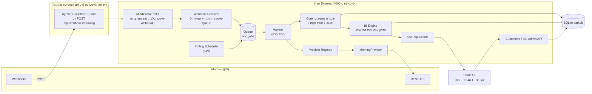
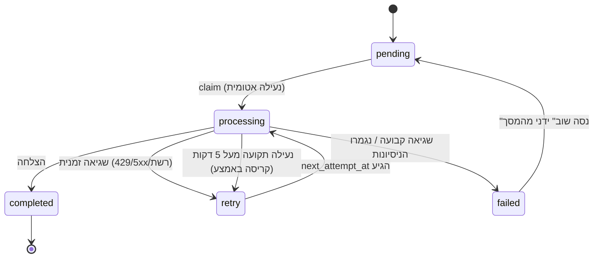
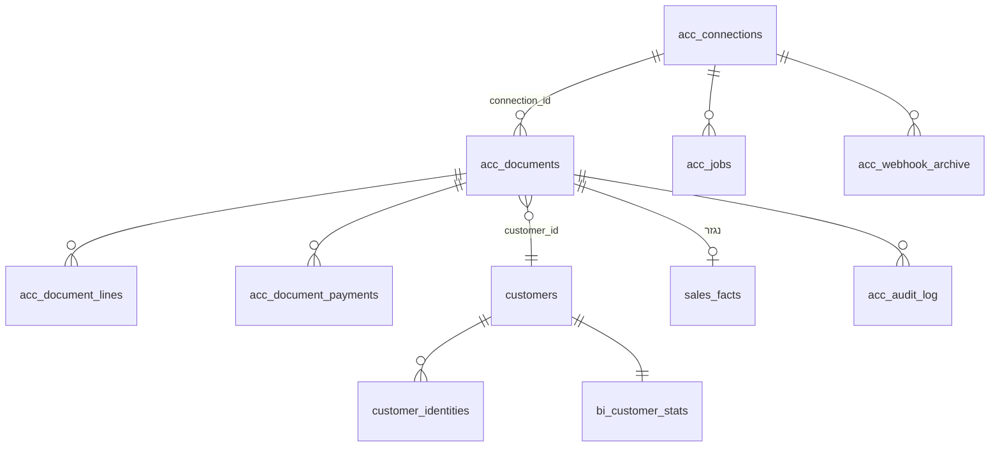
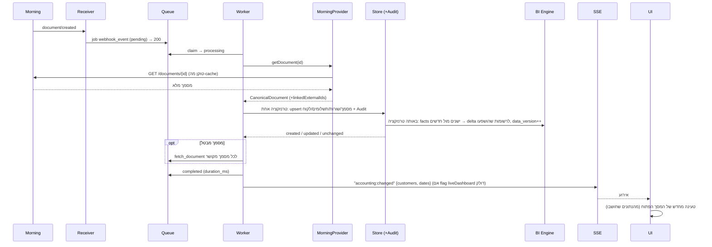

# מסמך Design: מודול "ניהול לקוחות"

סטטוס: **טיוטה לאישור, גרסה 2.** עוד לא נכתב קוד.
מה חדש בגרסה 2: עדכון BI אינקרמנטלי ברמת רשומה (סעיף 11), ארכיון Webhooks גולמי (סעיף 6.1), ו-Feature Flags (סעיף 18).
מקור הנתונים על Morning: הקובץ הרשמי של ה-API, [openapi.bundled.json](https://developers.morning.co/docs/openapi.bundled.json), גרסה 2.0.0.

---

## 1. עקרונות

1. **שרת אחד.** כל הקוד החדש נכנס לשרת ה-Express הקיים, תחת `backend/accounting/`, בלי תהליך או פורט נוסף.
2. **Webhooks הם המנגנון הראשי.** בדיקה מחזורית (Polling) משמשת רק לגיבוי ולהתאמה.
3. **הליבה לא מכירה את Morning.** מודול הלקוחות, ה-BI והמסכים עובדים מול מודל נתונים קנוני. כל ספק (Morning ובעתיד ספקים אחרים) הוא Provider שמממש ממשק אחד.
4. **שום אירוע לא הולך לאיבוד.** כל אירוע נשמר קודם כל ב-Queue שנשמר בבסיס הנתונים, ורק אחר כך עובר עיבוד.
5. **כל שינוי מתועד.** כל כתיבה של מסמך או לקוח נרשמת ב-Audit Log, באותה טרנזקציה של השינוי עצמו.
6. **הדשבורד קורא נתונים שחושבו מראש.** כל אירוע מעדכן רק את רשומות הסיכום שהושפעו ממנו, בתוספת או בהפחתה (delta). אין חישוב מחדש של יום, חודש או טבלה.
7. **כל Webhook נשמר כפי שהתקבל**, בארכיון לקריאה בלבד שלא משמש את הלוגיקה העסקית.
8. **כל מנגנון ניתן לכיבוי בנפרד** (Feature Flags), כדי לבודד תקלה בלי להשבית את כל המודול.
9. **בלי פגיעה במודולים הקיימים.** השינויים בקוד הקיים הם תוספות בלבד: נתיב בשרת, פריט בתפריט, תזמון, וחריגה אחת ממגבלת הגישה המקומית, שמפורטת בסעיף 6.

## 2. מה Morning מספקת: עובדות שקובעות את התכנון

| נושא | מה קיים |
|---|---|
| הזדהות | `POST https://api.morning.co/idp/v1/oauth/token` עם `client_id` ו-`client_secret`. מחזיר `accessToken`, שתקף לשעה (`expiresAt`) |
| נתונים | `https://api.greeninvoice.co.il/api/v1`. Sandbox: `api.sandbox.morning.dev` ו-`sandbox.d.greeninvoice.co.il/api/v1` |
| חיפוש מסמכים | `POST /documents/search`: סינון לפי `fromDate`, `toDate`, `type`, `status`, `paymentTypes`, `clientId`, ו-`page`/`pageSize` (ברירת מחדל 25). מיון: `documentDate`, `dueDate`, `client` |
| מסמך בודד | `GET /documents/{id}`: כולל `linkedDocuments`, `client.mobile` ו-`discount` |
| קישורי PDF | `url.he` / `url.origin` במסמך, ו-`GET /documents/{id}/download/links`. התיעוד לא מציין תוקף לקישורים |
| שורות פריטים | `income[]`: `description`, `catalogNum`, `itemId`, `quantity`, `price`, `amount`, `amountTotal`, `vat` |
| תשלומים | `payment[]`: `type` (0 ניכוי במקור, 1 מזומן, 2 צ׳ק, 3 אשראי, 4 העברה, 5 PayPal, 10 אפליקציה, 11 אחר), `appType` (Bit, Pay, PayBox...), `price` |
| סטטוס מסמך | 0 פתוח, 1 סגור, 2 נסגר ידנית, 3 מסמך מבטל, 4 בוטל |
| **תאריך עדכון של מסמך** | **לא קיים.** יש רק `creationDate`. ללקוחות יש `lastUpdateDate` |
| **Webhooks** | מוגדרים בממשק של Morning. חתימת HMAC-SHA256 על הגוף הגולמי, בכותרת `x-webhook-signature`, כשמוגדר סוד. כותרות: `x-webhook-topic`, ‏`x-webhook-delivery-id` ו-`x-webhook-timestamp`. **אחרי 15 כישלונות ה-Webhook מושבת** |
| אירועים רלוונטיים | `document/created`, `client/created`, `payment/received`. **אין אירוע לעדכון או לביטול מסמך.** ביטול יוצר "מסמך מבטל" חדש, ולכן נשלח `document/created` |
| מגבלת קצב | **לא מתועדת** |

**המשמעות:** שינויי סטטוס שלא יוצרים מסמך חדש, למשל סגירה ידנית, לא נשלחים כאירוע. לכן חייבת להיות גם התאמה מחזורית, אבל רק בתפקיד גיבוי (סעיף 8).

## 3. תרשים ארכיטקטורה



## 4. מבנה הקוד

```
backend/accounting/
  providers/
    index.js            רישום Providers: getProvider(name)
    base.js             החוזה (JSDoc) ובדיקת תאימות של Provider בטעינה
    morning/
      client.js         HTTP: טוקן (cache עד expiresAt), ניסיונות חוזרים, 401→טוקן חדש, 429/5xx→המתנה
      mapper.js         המרת מסמך/לקוח של Morning למודל הקנוני (קודים → ערכים קנוניים)
      webhooks.js       אימות חתימה ופענוח אירוע ל-[{ kind, externalId }]
      index.js          המימוש: testConnection, listDocuments, getDocument, getPdfLinks, ...
  model.js              המודל הקנוני ופונקציות עזר (אגורות, נרמול טלפון)
  store.js              כתיבה למסד: upsert למסמך, לשורות, לתשלומים וללקוח, ו-Audit באותה טרנזקציה
  identity.js           זיהוי לקוח: מזהה ספק → טלפון מנורמל → שם
  queue.js              enqueue, claim, complete, fail, retry, שחרור נעילות תקועות
  worker.js             לולאת עיבוד ו-handlers לכל סוג Job
  polling.js            תזמון הגיבוי: check_new / reconcile_recent / reconcile_full
  audit.js              חישוב הבדלים ורישום
  bi/
    rules.js            מה נחשב עסקה (לפי ערכים קנוניים בלבד)
    facts.js            הפקת שורות sales_facts למסמך
    delta.js            הפרש בין ה-facts הישנים לחדשים של מסמך → עדכון delta של רשומות הסיכום
    verify.js           בדיקת סחיפה: חישוב מלא ברקע והשוואה לסיכומים, ותיקון
    queries.js          שאילתות לדשבורד ולרשימות, עם cache בזיכרון לפי גרסת נתונים
  flags.js              Feature Flags: ברירות מחדל, דריסה מ-.env, ערכים מהמסך
  health.js             מדדי ניטור וכללי אזהרה
  events.js             SSE: שידור "נתונים השתנו" ו"סטטוס ניטור"
backend/routes/
  accounting.js         חיבורים, סנכרון, Queue, Audit, Health
  customers.js          רשימה, כרטיס, ייצוא ל-Excel, PDF
  bi.js                 דשבורד
  webhooks.js           (קיים) מקבל גם את POST /api/webhooks/morning דרך accounting
frontend/src/pages/customers/
  CustomersPage.jsx     לשוניות: לקוחות | דשבורד | סנכרון והגדרות
  CustomersList.jsx · CustomerCard.jsx · BIDashboard.jsx · SyncSettings.jsx
frontend/src/customers/
  biFormat.js           עיצוב מספרים, תאריכים ושמות אמצעי תשלום
  useLiveData.js        האזנה ל-SSE וטעינה מחדש
```

הקוד ייכתב ב-JavaScript, כמו שאר הפרויקט, עם הערות JSDoc ובדיקות קלט בשרת. פרויקט TypeScript לא מתאים כאן, כי הוא היה שובר את המוסכמות הקיימות.

## 5. שכבת ה-Providers

### החוזה

```js
/**
 * @typedef {Object} AccountingProvider
 * @property {string} id                 'morning'
 * @property {string} label              'Morning'
 * @property {{ webhooks: boolean, lineItems: boolean, pdfLinks: boolean,
 *              updatedSinceFilter: boolean, documentUpdateEvents: boolean }} capabilities
 * @property {(conn) => Promise<{ok: boolean, account?: string, error?: string}>} testConnection
 * @property {(conn, {from, to, page, pageSize, newestFirst}) => Promise<{items: CanonicalDocument[], hasMore: boolean}>} listDocuments
 * @property {(conn, externalId) => Promise<CanonicalDocument|null>} getDocument
 * @property {(conn, externalId) => Promise<{pdf: string|null}>} getPdfLinks
 * @property {(conn, req) => {valid: boolean, reason?: string}} verifyWebhook
 * @property {(conn, req) => {deliveryId: string, topic: string, refs: {kind: 'document'|'customer', externalId: string}[]}} parseWebhook
 */
```

היכולות (`capabilities`) קובעות את ההתנהגות של הליבה. למשל, ל-Morning אין `documentUpdateEvents`, ולכן הליבה מפעילה התאמה מחזורית של סטטוסים. ל-Provider עתידי שיש לו את היכולת הזו, ההתאמה תהיה תדירה פחות.

### המודל הקנוני

| שדה | תיאור |
|---|---|
| `provider`, `externalId` | ביחד: מפתח ייחודי, שמונע כפילויות |
| `kind` | `invoice` · `invoice_receipt` · `receipt` · `credit_note` · `quote` · `other` |
| `status` | `open` · `closed` · `cancelled` · `cancelling` |
| `number`, `date`, `createdAt`, `currency` | |
| `totals` | `gross`, `net` ו-`vat`, באגורות, במטבע מקומי |
| `customer` | `externalId?`, `name`, `phone?`, `email?` |
| `lines[]` | `sku?`, `externalItemId?`, `description`, `quantity`, `unitPrice`, `total` |
| `payments[]` | `method` (`cash`/`card`/`bank_transfer`/`cheque`/`app`/`paypal`/`withholding`/`other`), `label`, `app?`, `amount` |
| `links.pdf`, `linkedExternalIds[]`, `raw` | `raw` הוא התשובה המקורית של הספק, לשימוש עתידי |

**המרת הקודים של Morning:** 305 → `invoice`, 320 → `invoice_receipt`, 400 → `receipt`, 330 → `credit_note`, 10 → `quote`, וכל השאר → `other`. סטטוס 0 → `open`, 1 ו-2 → `closed`, 3 → `cancelling`, 4 → `cancelled`.

**הוספת ספק בעתיד** (iCount, ריווחית, Priority, חשבשבת): תיקייה חדשה תחת `providers/`, ורישום שלה ב-`index.js`. שום שינוי בליבה, ב-BI או במסכים.

## 6. Webhooks (שלב 3, כפי שאושר ומומש)

**עיקרון:** Webhook הוא **טריגר בלבד**. ה-API Pull (שלב 2) נשאר מקור האמת: אירוע רק מכניס ל-Queue משימה שמושכת את הרשומה מה-API. תוכן האירוע לא נשמר ולא משמש כנתון.

### מה Morning מספקת (OpenAPI 2.0.0, חלק Webhooks)
- **הגדרה:** בממשק של Morning בלבד (כלי מפתחים ← Webhooks): כתובת, אירועים, וסוד אופציונלי של עד 32 תווים.
- **חתימה:** `x-webhook-signature` = HMAC-SHA256 בפורמט hex של **הגוף הגולמי**. הכותרות, כולל `x-webhook-timestamp` ו-`x-webhook-delivery-id`, **לא חתומות**.
- **כותרות:** `x-webhook-topic`, `x-webhook-id`, `x-webhook-delivery-id`, `x-webhook-timestamp`, `x-correlation-id`, `user-agent: morning webhooks x.y`.
- **אישור קבלה:** 200, 201, 202 או 204. כל השאר נחשב כישלון, ו**אחרי 15 כישלונות ה-Webhook מושבת** ומופעל מחדש ידנית.
- **מה לא מתועד:** שליחה חוזרת, timeout, סדר אירועים, כתובות IP ומגבלת קצב.
- **אירועים:** רק יצירה (`client/created`, `document/created`, `payment/received` ועוד). אין אירוע עדכון או מחיקה.

### נקודת הקצה: מאזין נפרד
השרת הראשי חוסם כל בקשה שלא מגיעה בשם `localhost`, ובקשה דרך מנהרה נושאת שם חיצוני. כדי לא לשנות את `server.js` ולא להחליש את ההגנה, ה-Webhook מתקבל ב**מאזין נפרד**, `backend/accounting/webhookReceiver.js`:
- **כתובת:** `127.0.0.1:WEBHOOK_PORT`, ברירת מחדל 4100. הוא עולה מתוך `startAccounting()`.
- **נתיב:** אחד בלבד, `POST /<provider>/<url-token>`. כל השאר מחזיר 404, וכתובת לא מוכרת אפילו לא נרשמת.
- **מנהרה:** ngrok או Cloudflare Tunnel מפנה **רק לפורט הזה**. הכתובת הציבורית נשמרת ב-`WEBHOOK_PUBLIC_URL` בקובץ `backend\.env`. המערכת עצמה (פורט 4000) נשארת מקומית בלבד.

```mermaid
sequenceDiagram
  participant M as Morning
  participant T as מנהרה
  participant R as Receiver (127.0.0.1:4100)
  participant Q as Queue
  participant W as Worker
  participant A as Morning API
  M->>T: POST /morning/<url-token>
  T->>R: (רק הפורט הזה)
  R->>R: נתיב → חיבור; קצב; חסימה; content-type; גודל
  R->>R: HMAC על הבתים הגולמיים (השוואה בזמן קבוע)
  R->>R: ארכיון: מטא-דאטה בלבד
  R->>Q: fetch_customer {externalId} (dedupe)
  R-->>M: 200 מיד (בלי קריאה ל-API, בלי retry בתוך הבקשה)
  Q->>W: עיבוד
  W->>A: GET /clients/{id}
  W->>W: upsert + Audit (source = webhook); retry של ה-Queue בכישלון
```

### URL token מול HMAC secret (`webhookConfig.js`)
| | URL token | HMAC secret |
|---|---|---|
| **תפקיד** | זיהוי נקודת הקצה והחיבור | אימות קריפטוגרפי שהשליחה מ-Morning |
| **יצירה** | 32 תווי base64url אקראיים (`crypto.randomBytes`) | 32 תווים אלפא-נומריים אקראיים, בלי הטיה, באורך המקסימלי של Morning |
| **שמירה** | `acc_connections.settings.webhook.pathToken` | `acc_connections.webhook_secret_enc`, מוצפן ב-AES-256-GCM |
| **תצוגה** | חלק מהכתובת במסך | **פעם אחת**, מיד אחרי היצירה. לא מוחזר שוב מה-API, לא נרשם ב-Audit ולא בלוג |
| **השוואה** | hash של שני הצדדים, ואחר כך `timingSafeEqual` | `timingSafeEqual` על ה-HMAC |
| **החלפה** | "החלף כתובת": הסוד לא משתנה, והכתובת הישנה מחזירה 404 | "החלף סוד": הכתובת לא משתנה, והסוד הישן נדחה |
| **מה מגן מה** | לא מגן לבד. הוא רק מונע מסריקה אקראית להגיע לבדיקת החתימה | ההגנה עצמה. בלי סוד כל שליחה נדחית |

- **מקור יחיד לסוד:** אי אפשר לקבוע סוד ידנית או לשנות את ההגדרות דרך `PUT /connections`. הנתיבים היחידים הם `POST /connections/:id/webhook/secret` ו-`.../token`.
- **הסתרה מהרשימה ומהיומן:** ההגדרה לא מופיעה ברשימת החיבורים וביומן השינויים.

### Feature Flag: `WEBHOOKS_ENABLED`
- **ברירת מחדל:** כבוי.
- **הדלקה:** **רק** במסך ההגדרות, בכרטיס "מתגים". השינוי נרשם ב-Audit.
- **ב-`backend\.env`:** `WEBHOOKS_ENABLED=false` נועל את המתג כבוי. `true` שם לא מדליק.
- **כשהמתג כבוי:** שליחה מאומתת נרשמת עם התוצאה `disabled` ומקבלת 200, בלי משימה. כך Morning לא סופרת כישלונות, וה-Pull ממשיך כרגיל.

### אירועים
| נושא | טיפול |
|---|---|
| `client/created` | **פעיל.** `fetch_customer(id)` |
| `document/created` | **לא פעיל עדיין.** נרשם כ-`ignored` ומקבל 200. יתווסף בשורה אחת ב-`providers/morning/webhooks.js` (`TOPICS`), ו-`fetch_document` ב-`JOB_FOR_KIND`, אחרי בדיקה, יחד עם סנכרון המסמכים |
| כל השאר | `ignored` ו-200 |

### תוצאות ותשובות
| מצב | תשובה | תוצאה בארכיון |
|---|---|---|
| נתיב או token לא מוכרים | 404 | לא נרשם |
| לא POST | 405 | לא נרשם |
| כתובת חסומה (10 חתימות שגויות ב-10 דקות) | 403 | לא נרשם (נספר בזיכרון) |
| מעל 60 בדקה לכתובת, או 300 בדקה בסך הכל | 429 | לא נרשם (נספר בזיכרון) |
| content-type שאינו JSON | 415 | `rejected` / `content_type` |
| מעל 1MB | 413 | `rejected` / `too_large` |
| אין סוד, או חתימה שגויה | 401 | `rejected` / `no_secret`, `bad_signature` |
| חתום, ומזהה שליחה שכבר התקבל | 200 | `duplicate` |
| חתום, מתג כבוי או חיבור מושבת | 200 | `disabled` |
| חתום, נושא לא פעיל | 200 | `ignored` |
| חתום, גוף לא קריא או בלי מזהה | 200 | `unreadable` |
| חתום ותקין | 200 | `accepted`, עם `job_id` |

### ארכיון: מטא-דאטה בלבד
`acc_webhook_archive` **לא שומרת את גוף השליחה**, גם לא של שליחה תקינה. נשמרים:
- `delivery_id`, `topic`, `webhook_id`, `event_timestamp`, `correlation_id`
- כותרות נבחרות בלבד (`KEPT_HEADERS`): בלי חתימה ובלי cookie
- `body_sha256`, `body_size`, `remote_ip`, `user_agent`, `signature_valid`, `outcome`, `rejection_reason`, `job_id`

**שמירה:** 30 יום, עם ניקוי אוטומטי כל שעה.

**"הרץ שוב":** יוצר מחדש את המשימה של שליחה מאומתת, מתוך ה-`payload` של המשימה המקורית, עם `source = replay`.

**Debug של payload, אם יידרש בעתיד:** ייבנה כמנגנון ייעודי וזמני, לא כשמירה קבועה.

### אמינות
- **כפילויות:**
  - אינדקס ייחודי על `(connection_id, delivery_id)` לשליחות `accepted`.
  - מפתח dedupe `fetch_customer:<חיבור>:<לקוח>` מאחד אירועים לאותו לקוח.
  - עיבוד חוזר לא כותב כלום, כי ה-hash זהה.
- **סדר:** לא משנה. כל משימה מושכת את המצב הנוכחי מה-API.
- **Retry:** רק ב-Queue. ה-Receiver לא קורא ל-Morning ולא מנסה שוב בתוך בקשת ה-HTTP. `ingest()` סינכרוני ועונה מיד.
- **Fallback:** ה-Pull רץ בתדירות הרגילה בכל מקרה.

### ניטור והתראה (`webhookHealth.js`)
Morning לא מודיעה כשהיא משביתה Webhook, ולכן:
- **כישלונות ברצף:** דחיות בארכיון, ו-403 או 429 שנספרו בזיכרון, מאז התשובה התקינה האחרונה. מ-3 ברצף מוצגת **תקלה**, עם הסבר שאחרי 15 Morning משביתה.
- **"הגיע רק מה-Pull":** לקוח שנוצר ב-Morning אחרי הפעלת ה-Webhooks, נשמר יותר מ-10 דקות אחרי שנוצר, ואין עליו משימת webhook. זה סימן ש-Morning הפסיקה לשלוח, ומוצגת **תקלה** עם הנחיה להפעיל מחדש ב-Morning. הבדיקה מסתכלת על 48 השעות האחרונות.
- **שקט:** אין אף אירוע 7 ימים, ומוצגת **אזהרה**.
- **התראה:**
  - בכרטיס ה-Webhook במסך.
  - ב-`GET /api/accounting/health`.
  - ובלוג השרת, פעם אחת בכל מעבר למצב תקלה. הבדיקה רצה כל דקה.

### Database
- **טבלאות חדשות:** אין.
- **עמודות חדשות:** `acc_webhook_archive.outcome` ו-`body_size`, ושני אינדקסים: אחד ייחודי לשליחות שהתקבלו, ואחד לחיבור.
- **הגדרות:** `settings.webhook` (`pathToken`, `secretSetAt`, `activatedAt`).

### נקודות קצה
`GET /connections/:id/webhook`, `POST /connections/:id/webhook/secret`, `POST /connections/:id/webhook/token`, `GET /webhook-deliveries`, `POST /webhook-deliveries/:id/replay`, `GET /health`.

## 7. ה-Queue

טבלה אחת (`acc_jobs`) משרתת את כל המקורות: Webhook, Polling וידני. כך יש מסלול עיבוד אחד, ולוגיקת שמירה אחת.

### מחזור חיים



### מבנה הטבלה

| עמודה | תיאור |
|---|---|
| `id` | מזהה רץ |
| `connection_id` | איזה חיבור (ספק) |
| `type` | `webhook_event` · `fetch_document` · `fetch_customer` · `check_new` · `reconcile_recent` · `reconcile_full` · `bi_rebuild` · `bi_verify` |
| `source` | `webhook` · `polling` · `manual` · `replay` · `system` |
| `payload` | JSON: מזהה המסמך או פרמטרי הטווח |
| `dedupe_key` | ייחודי, למשל `wh:<delivery-id>` או `doc:<externalId>` כשממתין. מונע כפילויות |
| `status` | `pending` · `processing` · `completed` · `failed` · `retry` |
| `attempts`, `max_attempts` | ברירת מחדל: 8 ניסיונות |
| `next_attempt_at` | המתנה הולכת וגדלה: 10 שניות, 30, 2 דקות, 10 דקות... ועד שעה |
| `locked_at`, `started_at`, `finished_at`, `duration_ms` | ניטור וזמן עיבוד |
| `last_error`, `result` | פירוט השגיאה, או סיכום (נוסף / עודכן / לא השתנה) |
| `created_at` | |

**אינדקסים:** `(status, next_attempt_at)` ו-`(created_at)`, ו-`dedupe_key` ייחודי.

**ה-Worker:**
- **מתי הוא רץ:** בתוך השרת, מיד כשמשהו נכנס ל-Queue, וגם כל 2 שניות.
- **נעילה:** כל Job ננעל בפקודה אטומית `UPDATE ... WHERE status IN ('pending','retry') ...`, כך שאותו Job לא מעובד פעמיים.
- **מקביליות:** 2 עבודות במקביל, כדי לא להעמיס על ה-API.
- **ניקוי:** עבודות שהושלמו נמחקות אחרי 30 יום. אירועים שנכשלו נשמרים.

**עומס של מאות אירועים בבת אחת:** כל אחד נשמר מיד, והם מעובדים לפי הסדר. Job של `fetch_document` לאותו מסמך שעדיין ממתין לא נכנס פעמיים.

## 8. Polling: גיבוי בלבד

| בדיקה | מה היא עושה | מתי היא רצה |
|---|---|---|
| `check_new` | מושכת את המסמכים מהחדש לישן, ונעצרת במסמך הראשון שכבר קיים. כשאין חדש, זו בקשה אחת | **בעליית השרת**, **כש-Webhook מסומן לא תקין** (כל 1, 5, 15 או 60 דקות, לבחירה; ברירת מחדל 5), ו**כבדיקת בטיחות כש-Webhook תקין** (כל 60 דקות, לתפוס אירוע ש-Morning לא שלחה) |
| `reconcile_recent` | 30 הימים האחרונים: שינויי סטטוס שלא נשלחו כאירוע, כמו סגירה ידנית | כל שעה (ניתן לשינוי) |
| `reconcile_full` | כל ההיסטוריה | פעם בשבוע, וכשמחברים לראשונה (טעינה ראשונית) |

**מתי Webhook מסומן לא תקין:**
- לא הוגדר סוד או כתובת.
- בבדיקת בטיחות נמצאו מסמכים חדשים שלא הגיע עליהם אירוע.
- היו 3 דחיות חתימה ברצף.
- אין אף אירוע 24 שעות, בזמן ש-`check_new` מצא מסמכים.

ב-Polling נוצרים Jobs רגילים ב-Queue, עם `source = polling`, כך שהשמירה, ה-Audit וה-BI זהים לגמרי לשינויים שמגיעים מ-Webhook.

**סדר עדיפויות:** התאמות רצות בעדיפות נמוכה, ו-Job של Webhook תמיד עוקף אותן.

## 9. Audit Log

טבלה `acc_audit_log`, שנכתבת באותה טרנזקציה של השינוי:

| עמודה | תיאור |
|---|---|
| `id`, `at` | מזהה ותאריך ושעה |
| `action` | `document.created` · `document.updated` · `document.status_changed` · `document.cancelled` · `customer.created` · `customer.updated` · `customer.merged` · `connection.*` · `flag.changed` · `webhook.replayed` · `bi.drift_repaired` |
| `source` | `webhook` · `polling` · `manual` · `replay` · `system` |
| `job_id` | איזה Job גרם לשינוי |
| `entity_type`, `entity_id`, `external_id` | למשל `document`, המזהה המקומי, והמזהה ב-Morning |
| `before`, `after` | המצב הקודם והמצב החדש, במודל הקנוני (בלי `raw`) |
| `changes` | שינויים ברמת שדה: `[{field, from, to}]` |

**מה נחשב שינוי:** מסמך שלא השתנה, לפי טביעת התוכן שלו, **לא** נרשם. כך התאמה מחזורית לא מנפחת את הלוג.

**אינדקסים:** `(entity_type, entity_id, at)`, `(at)` ו-`(action)`.

**הצגה:** Audit מוצג בכרטיס הלקוח ("היסטוריית שינויים") ובמסך הניטור.

## 10. מבנה מסד הנתונים



| טבלה | תפקיד ושדות עיקריים |
|---|---|
| `acc_connections` | חיבור לספק: `provider`, `label`, `environment` (production/sandbox), `credentials_enc` (מוצפן), `webhook_secret_enc`, `settings` (תדירויות, מאיזה תאריך), `status`, `last_ok_at` |
| `acc_documents` | `connection_id` + `external_id` (**ייחודי**), `kind`, `status`, `number`, `doc_date`, `created_at_ext`, `currency`, `gross`/`net`/`vat` באגורות, `customer_id`, `customer_name`, `customer_phone`, `customer_email`, `primary_payment_method`, `pdf_url`, `linked_ids`, `raw`, `content_hash`, `first_seen_at`, `changed_at`, `synced_at` |
| `acc_document_lines` | `document_id`, `row`, `sku`, `external_item_id`, `description`, `product_key` (מפתח מנורמל לניתוח מוצרים), `quantity`, `unit_price`, `total` |
| `acc_document_payments` | `document_id`, `row`, `method`, `label`, `app`, `amount` |
| `customers` | `id`, `display_name`, `phone`, `phone_norm`, `email`, `created_at`, `updated_at` |
| `customer_identities` | `customer_id`, `connection_id`, `kind` (`external_id`/`phone`/`name`), `value`. **ייחודי** לכל `(connection_id, kind, value)`. כך לקוח אחד יכול להופיע בכמה ספקים |
| `acc_customer_records` | (שלב 2) הלקוח כפי שהוא אצל הספק: `connection_id` + `external_id` (**ייחודי**), `customer_id`, שם, טלפונים, מיילים, ח"פ, כתובת, איש קשר, `active`, תוויות, הערות, `income_agorot`/`payment_agorot`/`balance_agorot` (מחושבים אצל הספק), `source_created_at`, `source_updated_at`, `raw` (בלי פרטי בנק), `content_hash`, `last_seen_run_id`, `missing_runs`, `removed_at`. **פרטי בנק לא נשמרים** |
| `acc_webhook_archive` | ארכיון גולמי, לקריאה בלבד (סעיף 6.1). אינדקסים: `delivery_id`, `received_at`, `topic` |
| `acc_feature_flags` | `key`, `enabled`, `updated_at`, `updated_by` (סעיף 18) |
| `acc_jobs` | סעיף 7 |
| `acc_audit_log` | סעיף 9 |
| `acc_sync_runs` | ריצת התאמה: `type`, `source`, `status` (running/completed/failed/cancelled), `started_at`, `finished_at`, `page_size`, `pages`, `fetched`/`added`/`updated`/`unchanged`/`failed`/`removed`, `item_errors`, `error` |

| `sales_facts` | שורה לכל מסמך שנחשב עסקה: `document_id`, `date`, `customer_id`, `gross`, `net` (בחשבונית זיכוי: שלילי), `method`, `deal_count` (1, או 0 בזיכוי) |
| `sales_fact_lines` | `document_id`, `date`, `customer_id`, `product_key`, `quantity`, `gross`, `net` |
| `bi_daily` | לפי `date`: `gross`, `net`, `deals`, `customers`, `new_customers` |
| `bi_daily_method` | לפי `(date, method)`: `gross`, `net`, `deals` |
| `bi_daily_product` | לפי `(date, product_key)`: `quantity`, `gross`, `net` |
| `bi_customer_stats` | לפי לקוח: `deals`, `gross`, `net`, `first_date`, `last_date`, `last_method`, `gap_days_sum`, `gap_count` (הממוצע = סכום חלקי מספר) |
| `bi_daily_customer` | לפי `(date, customer_id)`: `deals`. מונה הפניות שמאפשר לעדכן את "לקוחות ביום" בלי לספור מחדש |
| `bi_monthly_new_customers` | לפי `month`: `count` |
| `bi_meta` | `data_version`, `last_verify_at`, `last_drift` |

**סנכרון לקוחות (שלב 2):**
- **מקור:** `POST /clients/search` בדפים של 100. ל-Morning אין סינון או מיון לפי `lastUpdateDate`, ולכן כל ריצה קוראת את כל הדפים, ורק שינוי אמיתי (`content_hash`) נכתב ונרשם ב-Audit.
- **משימות:** `customers_sync` → `customers_page` (דף אחד לכל משימה) → `customers_finalize`. ‏`fetch_customer` מושך לקוח בודד, וישמש את ה-Webhook של `client/created`.
- **תזמון:** סנכרון ראשון אחרי בדיקת חיבור מוצלחת, ואחר כך כל 15 דקות, שעה (ברירת מחדל) או 6 שעות. נשלט על ידי `polling` ו-`autoSync`.
- **זיהוי לקוח:** מזהה הספק, ואחר כך טלפון מנורמל. **שם בלבד לא מאחד לקוחות.**
- **Audit:** `customer.created`, `customer.updated`, `customer.deactivated`, `customer.reactivated`, `customer.identity_linked`, `customer.removed_in_source`, `customer.restored_in_source`. שינוי רק בסכומים המחושבים נשמר, אבל לא נרשם, כי הוא נגזר ממסמכים.
- **הסרה:** לקוח שלא הוחזר בשתי ריצות מלאות ברצף מסומן "הוסר במקור" ולא נמחק. אם ריצה החזירה פחות מחצי מהלקוחות המוכרים, או שחלק מהלקוחות לא נשמרו, סימון ההסרה מדולג.

**סנכרון מסמכים (שלב 2ב):**
- **מקור:** `POST /documents/search` בדפים של 100, ממוינים לפי תאריך המסמך. החיפוש כבר מחזיר שורות פריטים (`income`) ותשלומים (`payment`), ולכן אין צורך בבקשה לכל מסמך. ‏`GET /documents/{id}` (`fetch_document`) מוסיף `linkedDocuments`, וישמש את ה-Webhook של `document/created` כשיופעל.
- **סדר:** כל סנכרון מריץ קודם לקוחות ואחר כך מסמכים (`customers_finalize` מפעיל `documents_sync`), כדי שקבלות יתחברו לכרטיסי לקוח קיימים. כישלון במסמכים לא משפיע על הלקוחות, ונרשם בריצה נפרדת (`acc_sync_runs.type = documents`).
- **מנוע אחד:** אותן משימות (`<entity>_sync`, `_page`, `_finalize`) לשני הסוגים. רק "קריאת דף", "שמירה" ו"סיום" שונים.
- **זיהוי הלקוח במסמך** (אושר: ברוב הקבלות יש רק שם): כרטיס לקוח (`client.id`), טלפון מנורמל, מייל, ושם זהה (בלי רווחים מיותרים). אם יש שני לקוחות עם אותו שם, לא מנחשים, ונוצר לקוח חדש. בכל מסמך נשמר `customer_match` (`external_id`, `phone`, `email`, `name` או `new`), כך שזיהוי לפי שם תמיד גלוי.
- **פרטי בנק:** תיאור של תשלום יכול להכיל מספר חשבון (בהעברה בנקאית). לכן הוא נשמר רק בתשלום באפליקציה, שם הוא שם האפליקציה. גם ב-`raw` הוא מוסר.
- **Audit:** `document.created` (עם `customerMatch`), `document.updated` (הבדלים לפי שדה), `document.cancelled`, ‏`customer.created` (`origin: document`) ו-`customer.identity_linked` (`linkedBy`) כששם, מייל או טלפון מתחברים ללקוח קיים בפעם הראשונה.
- **הסרה:** מסמכים לא מסומנים כהוסרו. מסמך חשבונאי לא נמחק אצל הספק, וביטול הוא מסמך חדש.
- **עמודות חדשות ב-`acc_documents`:** `type_code`, `customer_external_id`, `customer_match`.
- **מה נמצא בחשבון בפועל (19/11/2026):** 104 מסמכים, כולם קבלות (400), בלי שורות פריטים. רק 26 מהן משויכות לכרטיס לקוח. ב-78 האחרות יש רק שם (ובחמש גם מייל), בלי טלפון, גם ב-API וגם במסך של Morning. תיאור חופשי ("ציר", "ציר וגהי", "בריא") קיים ב-55 קבלות. **המשמעות לשלב ה-BI:** "עסקה" בעסק הזה היא קבלה, ולא חשבונית (ההחלטה בסעיף 19 צריכה עדכון). ניתוח מוצרים אפשרי רק מהתיאור החופשי, ולכן הוא יהיה משוער.

**פרטים טכניים:**
- **סכומים** נשמרים באגורות, כמו במודול הכספים.
- **פרטי ההתחברות** מוצפנים ב-AES-256-GCM, עם מפתח מקובץ `backend\.env` (`ACCOUNTING_SECRET_KEY`), שנוצר אוטומטית בהפעלה הראשונה.
- **שינויים בקוד הקיים:** אין. כל הטבלאות חדשות, ונוצרות באותה שיטה של `db.js`.

## 11. BI אינקרמנטלי ו-Cache

**העיקרון:** כל שינוי במסמך מעדכן רק את רשומות הסיכום שהושפעו ממנו, בתוספת או בהפחתה. אין חישוב מחדש של יום, חודש או טבלה, ולכן עלות העדכון לא תלויה בכמות המסמכים במערכת, ונשארת קבועה גם במיליוני מסמכים.

### איך עדכון אחד עובד

בתוך **אותה טרנזקציה** של שמירת המסמך:
1. קוראים את ה-facts **הישנים** של המסמך (אם היה), ומפיקים את ה-facts **החדשים** לפי `bi/rules.js`.
2. מחשבים את ההפרש (חדש פחות ישן), ומחילים אותו על הרשומות שהושפעו בלבד:

| רשומה | עדכון | עלות |
|---|---|---|
| `bi_daily` (תאריך המסמך, וגם התאריך הישן אם השתנה) | `gross += Δ`, `net += Δ`, `deals += Δ` | שורה 1–2 |
| `bi_daily_method` | אותו דבר, לכל אמצעי תשלום שהשתנה | שורות בודדות |
| `bi_daily_product` | אותו דבר, לכל מוצר במסמך | כמספר שורות הפריטים |
| `bi_daily_customer` | `deals += Δ`. כשהמונה עובר בין 0 ל-1, משנים `bi_daily.customers` ב-±1 | שורה 1 |
| `bi_customer_stats` של **הלקוח הזה** | מונים וסכומים ב-Δ. רכישה ראשונה ואחרונה, אמצעי תשלום אחרון ופערים בין רכישות מחושבים מחדש **רק מהעסקאות של הלקוח הזה**, לפי אינדקס | כמספר העסקאות של הלקוח |
| `bi_monthly_new_customers` | אם הרכישה הראשונה של הלקוח זזה בין חודשים: ‎-1 בחודש הישן ו-+1 בחודש החדש | שורות 1–2 |

3. `data_version` עולה ב-1, וזה מבטל את ה-Cache בזיכרון.

מכיוון שהכול קורה באותה טרנזקציה, אין מצב שבו המסמך נשמר אבל הסיכום לא, ולהפך. גם שני Workers שרצים במקביל לא יכולים "לדרוס" זה את זה, כי SQLite מבצע כתיבות בזו אחר זו.

**טעינה ראשונית** של היסטוריה שלמה עוברת באותו מסלול, מסמך אחרי מסמך, בקבוצות של 500 בטרנזקציה.

### הגנה מסחיפה

- **בדיקה תקופתית:** Job מסוג `bi_verify` רץ פעם בשבוע ברקע, מחשב הכול מאפס מה-facts ומשווה לסיכומים.
- **סחיפה:** אם נמצא הבדל, הוא נרשם ב-Audit (`bi.drift_repaired`) ובניטור, והסיכום מתוקן.
- **בנייה מלאה:** `bi_rebuild` זמין גם ידנית, וגם כשמדליקים מחדש את ה-flag `biCache`.

### שכבות הקריאה

1. **Facts:** שורה לכל עסקה, ושורה לכל פריט בעסקה.
2. **סיכומים שמורים**, שמתעדכנים כמו בטבלה למעלה.
3. **Cache בזיכרון לשאילתות עם פילטרים:**
   - **מפתח:** שם השאילתה, הפילטרים ו-`data_version`. המספר הזה עולה בכל עדכון, וכך תוצאה ישנה אף פעם לא מוצגת.
   - **גודל:** עד 200 תוצאות, והפחות-שימושיות נמחקות ראשונות.

**איך עונים על כל שאלה בדשבורד:**

| שאלה | מקור |
|---|---|
| הכנסות לפי יום, שבוע, חודש ושנה, השוואות וצמיחה | `bi_daily`. שבוע, חודש ושנה מסוכמים מהימים |
| הכנסות לפי אמצעי תשלום | `bi_daily_method` |
| מוצרים מובילים והתפלגות | `bi_daily_product` |
| לקוחות מובילים, חוזרים, זמן בין רכישות, רכישה ראשונה ואחרונה | `bi_customer_stats` |
| לקוחות חדשים לפי חודש | `bi_monthly_new_customers` |
| מספר לקוחות שקנו בטווח תאריכים | `bi_daily_customer` (ספירה ייחודית לפי אינדקס) |
| **פילטר לפי לקוח או מוצר** | שאילתה על `sales_facts` ו-`sales_fact_lines`, עם אינדקסים, ותוצאה שנשמרת ב-Cache |

**ביצועים צפויים:**
- **עדכון של מסמך אחד:** כמה מילישניות, בלי קשר לכמות המסמכים במערכת.
- **דשבורד בלי פילטר:** קריאה של כמה אלפי שורות סיכום. מתחת ל-50ms, גם במיליון מסמכים.
- **פילטר לפי לקוח:** לפי אינדקס, רק העסקאות של הלקוח. מהיר בכל גודל.
- **פילטר לפי מוצר בטווח ארוך:** `bi_daily_product`, מתחת ל-300ms ב-200 אלף מסמכים, ואחר כך מה-Cache.
- **אימות:** אבדוק בבדיקת עומס עם 200 אלף מסמכים מומצאים, וגם עם מיליון לעדכון הבודד ולדשבורד בלי פילטר. אדווח על המספרים שיתקבלו בפועל.

**ההגדרות העסקיות** נמצאות ב-`bi/rules.js`, בלי תלות בספק:
- **עסקה:** `invoice` או `invoice_receipt`, שלא בוטלה (`cancelled`). חשבונית זיכוי מקטינה את הסכום ולא נספרת כעסקה. `receipt` נשמר, אבל לא נספר, כדי לא לספור פעמיים.
- **לקוח חדש בחודש:** הרכישה הראשונה שלו הייתה באותו חודש.
- **לקוח חוזר:** יש לו לפחות 2 עסקאות.
- **זמן ממוצע בין רכישות:** ממוצע הפערים, רק אצל לקוחות חוזרים.
- **זיהוי מגמה:** שיפוע של 6 החודשים האחרונים. "עלייה" או "ירידה" אם השינוי הוא יותר מ-3% בחודש, ואחרת "יציב".

### הדשבורד כפי שמומש (שלב 5)
- **חישוב:** מתוך המסמכים המסונכרנים, בכל בקשה (`accounting/bi.js`). התשובה נשמרת ב-cache בזיכרון לפי "גרסת נתונים": מספר המסמכים, `changed_at` האחרון, הלקוחות והמזהים. כל מסמך חדש או שינוי מבטלים אותה. עם 104 מסמכים החישוב לוקח כ-30ms, ותשובה מה-cache פחות מ-1ms. המתג `biCache` כבוי מחשב כל פעם מחדש.
- **טבלאות הסיכום האינקרמנטליות** (`bi_daily` וכו', למעלה) עוד לא בשימוש. הן נשארות לשלב 6, אם נפח הנתונים יצדיק אותן. התוצאה זהה, כי שתי הדרכים מחשבות מאותם מסמכים לפי אותם כללים.
- **רכישה ראשונה מול חוזרת:** כל רכישה היא הרכישה הראשונה אי-פעם של הלקוח, או רכישה חוזרת. "לקוחות חדשים" בתקופה הם מספר הרכישות הראשונות בה.
- **מה מוצג:**
  - **מדדים:** הכנסות, רכישות, ממוצע לרכישה, לקוחות שקנו, לקוחות חדשים ואחוז הרכישות החוזרות, עם שינוי באחוזים מול תקופה באורך זהה שקדמה לה.
  - **גרפים:** הכנסות לפי חודש או שבוע (שבוע מתחיל ביום ראשון), ורכישות ראשונות מול חוזרות, עם טבלת נתונים.
  - **פילוחים:** אמצעי תשלום, מוצרים, ימים בשבוע, ו-10 הלקוחות המובילים (לחיצה פותחת את הכרטיס).
  - **שימור:** כמה לקוחות חזרו תוך 30, 60 ו-90 יום, וחציון הימים בין רכישות.
- **מוצרים:** אין שורות מוצרים בקבלות, ולכן המוצר נקרא מהתיאור החופשי לפי מילות מפתח (ציר, גהי, ערכה, טאלו). קבלה שמזכירה שני מוצרים נספרת בשניהם. "בריא" לבד הוא "לא מפורט", ותיאור ריק הוא "ללא תיאור". כשיהיו שורות פריטים (בחשבוניות), הן ישמשו במקום התיאור.
- **שימור:** נספרים רק לקוחות שהרכישה הראשונה שלהם הייתה לפחות N ימים לפני היום האחרון בנתונים, כדי שלא ייחשבו "לא חזרו" לקוחות שעוד לא הספיקו.
- **פילטרים שלא מומשו מסעיף 14:** `customerId`, `product`, `method` ו-`vat`. העסק פטור ממע"מ, ולכן ברוטו ונטו זהים.
- **צבעים:** ירוק ההכנסות של מודול הכספים, וכחול/כתום לרכישות ראשונות/חוזרות. נבדקו לעיוורון צבעים ולניגודיות במצב בהיר וכהה. בפסים האופקיים הערך כתוב ליד כל פס, כך שהזיהוי לא תלוי בצבע.
- **נקודת קצה:** `GET /api/accounting/bi/dashboard?from&to&granularity=month|week`.

## 12. תרשים זרימה: מאירוע ועד הדשבורד



**זמן כולל צפוי:** 1 עד 3 שניות מהרגע ש-Morning שולחת ועד שהמסך מתעדכן. רוב הזמן הוא קריאת ה-API ל-Morning.

## 13. מסך הניטור (בלשונית "סנכרון והגדרות")

מתעדכן בזמן אמת דרך SSE:

| מדד | מקור | מתי מוצגת אזהרה |
|---|---|---|
| חיבור ל-Morning | בדיקת טוקן אחרונה | הטוקן נדחה, או שאין חיבור |
| מצב ה-Webhook | `acc_webhook_archive` וכללי סעיף 8 | לא תקין, או 3 דחיות חתימה ברצף |
| האירוע האחרון שהתקבל | `received_at` האחרון בארכיון | אין אירוע 24 שעות, בזמן שנמצאו מסמכים חדשים |
| Feature Flags | `acc_feature_flags` ו-`.env` | כל מנגנון כבוי מוצג כאזהרה צהובה, עם מה שהוא משבית |
| סחיפת BI | `bi_meta` | הבדיקה האחרונה מצאה הבדל |
| הסנכרון האחרון | `acc_sync_runs` | כישלון |
| אירועים שממתינים ב-Queue | `pending` + `retry` | יותר מ-50, או אירוע שממתין יותר מ-5 דקות |
| אירועים שנכשלו | `failed` | יותר מ-0, עם כפתור "נסה שוב" ופירוט השגיאה |
| זמן עיבוד ממוצע | `duration_ms` בשעה האחרונה | יותר מ-10 שניות |
| מצב ה-Polling | מצב התזמון | מושבת, או כשל ברצף |
| מגבלת קצב | 429 אחרונים | התקבלו 429 בשעה האחרונה |

## 14. נקודות קצה חדשות

**פתוחה מבחוץ (דרך המנהרה):**

| Method | נתיב | תיאור |
|---|---|---|
| POST | `/api/webhooks/morning` | קבלת אירוע: אימות חתימה, שמירה ב-Queue ותשובת 200 |

**מקומיות בלבד:**

| Method | נתיב | תיאור |
|---|---|---|
| GET | `/api/accounting/providers` | ספקים זמינים ויכולותיהם |
| GET / POST | `/api/accounting/connections` | רשימה / יצירת חיבור (הסודות לא מוחזרים לעולם) |
| PUT / DELETE | `/api/accounting/connections/:id` | עדכון הגדרות / ניתוק |
| POST | `/api/accounting/connections/:id/test` | בדיקת חיבור |
| POST | `/api/accounting/connections/:id/sync` | `{ mode: 'new' \| 'recent' \| 'full' }` סנכרון ידני |
| GET | `/api/accounting/health` | כל מדדי הניטור והאזהרות |
| GET | `/api/accounting/jobs` | ה-Queue, עם סינון לפי סטטוס וחלוקה לעמודים |
| POST | `/api/accounting/jobs/:id/retry` | ניסיון חוזר לאירוע שנכשל |
| GET | `/api/accounting/sync-runs` | לוג ההתאמות |
| GET | `/api/accounting/audit` | Audit, עם סינון לפי ישות, פעולה, מקור ותאריכים |
| GET | `/api/accounting/webhook-archive` | הארכיון הגולמי, עם סינון וחלוקה לעמודים (קריאה בלבד) |
| GET | `/api/accounting/webhook-archive/:id` | אירוע גולמי מלא: כותרות וגוף |
| POST | `/api/accounting/webhook-archive/:id/replay` | הרצה מחדש של אירוע מאומת, כ-Job חדש |
| GET / PUT | `/api/accounting/flags` | מצב ה-Feature Flags / שינוי (נדחה אם ננעל ב-`.env`) |
| POST | `/api/accounting/bi/rebuild` | בנייה מלאה של סיכומי ה-BI ברקע |
| GET | `/api/customers` | רשימה: `q`, פילטרים, `sort`, `page`, `pageSize` |
| GET | `/api/customers/export.xlsx` | ייצוא ל-Excel של הרשימה המסוננת |
| GET | `/api/customers/:id` | כרטיס: פרטים, סיכום והיסטוריית רכישות |
| GET | `/api/customers/:id/audit` | היסטוריית שינויים של הלקוח |
| GET | `/api/documents/:id/pdf` | הפניה לקישור ה-PDF, עם רענון הקישור מהספק אם צריך |
| GET | `/api/bi/summary` | מדדים מרכזיים |
| GET | `/api/bi/revenue` | `granularity=day\|week\|month\|year`, השוואות וצמיחה |
| GET | `/api/bi/customers` | חדשים לפי חודש, חוזרים, 10 מובילים, זמן בין רכישות |
| GET | `/api/bi/products` | 10 מובילים לפי כמות ולפי הכנסה, והתפלגות |
| GET | `/api/bi/trends` | מגמות |
| GET | `/api/bi/filter-options` | אפשרויות לפילטרים |
| GET | `/api/events` | SSE: עדכונים חיים |

כל נקודות ה-BI מקבלות את אותם פילטרים: `from`, `to`, `customerId`, `product`, `method` ו-`vat=gross|net`.

## 15. מסכים

פריט חדש בתפריט, **"ניהול לקוחות"**, עם שלוש לשוניות. כולן ברכיבים הקיימים, בעברית ובמצב כהה.

1. **לקוחות:**
   - **טבלה:** חלוקה לעמודים בצד השרת, חיפוש מיידי (עם השהיה קצרה), סינון, מיון וייצוא ל-Excel.
   - **כרטיס לקוח:** פרטים וסיכום, היסטוריית רכישות עם קישור ל-PDF, והיסטוריית שינויים.
2. **דשבורד עסקי:** שורת פילטרים, מדדים, ניתוח לקוחות, ניתוח מוצרים, הכנסות, מגמות, וטבלה לכל גרף.
3. **סנכרון והגדרות:**
   - **חיבור:** פרטי חיבור לספק, ובדיקת חיבור.
   - **Webhook:** הכתובת להדבקה ב-Morning, והסוד.
   - **תדירויות** הגיבוי.
   - **ניטור:** מסך הניטור (סעיף 13), ה-Queue עם "נסה שוב", Audit ולוג סנכרון.

**מסך הלקוחות כפי שמומש (שלב 4):**
- **מה נחשב רכישה:** קבלה או חשבונית מס/קבלה שלא בוטלה. חשבונית מס מוצגת בכרטיס, אבל לא נספרת, כי אצל עסק שמפיק חשבונית ואחריה קבלה היא הייתה נספרת פעמיים. חשבונית זיכוי מקטינה את הסכום. מסמך שבוטל (או מבטל) לא נספר. **לקוח חוזר** הוא לקוח עם שתי רכישות או יותר.
- **רשימה:** ארבעה מדדים (לקוחות, חוזרים, סך הרכישות, ממוצע ללקוח). חיפוש לפי שם, טלפון (בכל פורמט) או מייל. סינון: הכול, קנו, חוזרים, קנו פעם אחת, בלי רכישות. מיון: רכישה אחרונה, סכום, מספר רכישות, רכישה ראשונה, שם. 50 בעמוד.
- **איך הלקוח זוהה:** כרטיס Morning, לפי מייל, לפי שם, או מקבלה. מוצג החיבור החלש ביותר: לקוח שיש לו קבלה שזוהתה רק לפי שם יסומן "לפי שם".
- **כרטיס לקוח:** פרטים, רכישות, סכום, ממוצע, ראשונה ואחרונה, ימים בממוצע בין רכישות, אמצעי תשלום, כל המסמכים (עם קישור ל-Morning ואופן הזיהוי של כל אחד), כרטיס הלקוח מ-Morning, המזהים והיסטוריית שינויים. הלשונית והלקוח הפתוח נשמרים בכתובת (`?customer=`), כך שכפתור "אחורה" עובד.
- **ייצוא:** קובץ CSV ב-UTF-8 עם BOM, שנפתח ישירות ב-Excel בעברית, לפי החיפוש והסינון הנוכחיים. כל תא במירכאות, ותא שמתחיל ב-`= + - @` מקבל `'` לפני, כדי ש-Excel לא יריץ אותו כנוסחה. נבחר CSV ולא xlsx כדי לא להוסיף ספרייה.
- **נקודות קצה:** תחת `/api/accounting`, כדי לא לשנות את `server.js`: `GET /customers` (עם `summary`), `GET /customers/:id`, `GET /customers/export.csv`.
- **אתר ההדגמה:** לקוחות וקבלות בדויים (`frontend/src/demo/customersDemo.js`). הייצוא מושבת שם.

## 16. בדיקות

הבדיקות ייכנסו לפרויקט, עם `node:test` ו-`npm test`:
- **Provider:** המרה של כל קודי Morning, טוקן שפג (401 → טוקן חדש), 429 ו-5xx עם המתנה, ומעבר בין עמודים.
- **Webhook:** חתימה נכונה, שגויה וחסרה, אותו משלוח פעמיים, ונושא לא מוכר.
- **Queue:** נעילה אטומית, ניסיונות חוזרים, נעילה תקועה, הגעה ל-`failed` ו"נסה שוב".
- **Store:** שמירה בלי כפילויות, "לא השתנה" לא נרשם ב-Audit, ביטול שמעדכן מסמך מקושר, וזיהוי לקוח לפי מזהה, טלפון ושם.
- **BI אינקרמנטלי:** אלפי שינויים אקראיים (יצירה, עדכון, ביטול, החלפת לקוח, החלפת תאריך) מעודכנים ב-delta, ובסוף התוצאה זהה לחישוב מלא מאפס. כל ההגדרות העסקיות. זיהוי ותיקון של סחיפה.
- **ארכיון:** כל בקשה נשמרת עם הבייטים המקוריים, גם כשהחתימה שגויה. אין נתיב שמשנה אותו. Replay יוצר Job חדש.
- **Feature Flags:** כל flag כבוי משבית רק את המנגנון שלו, ערך מ-`.env` גובר על המסך, וכל שינוי נרשם ב-Audit.
- **עומס:** 200 אלף מסמכים מומצאים: זמני טעינה ראשונית, זמני עדכון ושאילתות דשבורד.
- **רגרסיה:** כל הבדיקות הקיימות של הלידים והאיסוף.
- **Sandbox:** בדיקה מול ה-Sandbox של Morning, אם תיצור מפתח Sandbox.

## 17. מגבלות ידועות

- **אירועי עדכון:** Morning לא שולחת אירוע על עדכון או סגירה של מסמך. עדכון כזה יופיע במערכת בהתאמה הבאה (ברירת מחדל: עד שעה).
- **זמינות:** Webhook דורש שהשרת והמנהרה יפעלו. אירוע שנכשל לא נשלח שוב באופן מתועד, ו-`check_new` משלים את הפער.
- **מגבלת קצב:** לא מתועדת. המערכת מאטה אוטומטית כשמגיע 429.
- **קישורי PDF:** התיעוד לא מציין תוקף לקישורים. אם יתברר שהם פגים, הקישור יתרענן בכל פתיחה, דרך `/download/links`.
- **מקום התיקייה:** בסיס הנתונים ומפתח ההצפנה נמצאים בתיקייה שמסונכרנת ל-OneDrive. מומלץ להעביר את המערכת לתיקייה מחוץ ל-OneDrive לפני עבודה עם נתונים אמיתיים בהיקף גדול.

## 18. Feature Flags

| Flag | כשהוא **כבוי** | מה ממשיך לעבוד |
|---|---|---|
| `webhooks` (`WEBHOOKS_ENABLED`, **ברירת מחדל: כבוי**, נדלק רק מהמסך) | נקודת הקצה ממשיכה לאמת ולשמור בארכיון, ועונה 200, אבל **לא יוצרת Jobs**. כך Morning לא סופרת כישלונות ולא משביתה את ה-Webhook | ה-Polling משלים את המסמכים, אם הוא דולק |
| `polling` | אין `check_new`, `reconcile_recent` ו-`reconcile_full` אוטומטיים | Webhooks, וסנכרון ידני מהמסך |
| `autoSync` | כל התזמונים מושבתים: Polling, התאמות ו-`bi_verify` | Webhooks וסנכרון ידני |
| `biCache` | הדשבורד מחושב ישירות מה-facts (איטי יותר, אבל נכון), ועדכוני ה-delta לסיכומים נעצרים | כל השאר. בהדלקה מחדש רץ `bi_rebuild` ברקע, והדשבורד עובר לסיכומים רק כשהבנייה מסתיימת |
| `liveDashboard` | אין SSE. המסכים מתרעננים כל 60 שניות ובכפתור "רענן" | כל השאר |

**איך מגדירים:**
- **ברירת מחדל:** כולם דולקים, חוץ מ-`webhooks`, שכבוי עד שמדליקים אותו במסך.
- **מסך ההגדרות:** מתג לכל flag. השינוי נכנס לתוקף מיד, בלי הפעלה מחדש, ונרשם ב-Audit (`flag.changed`).
- **קובץ התצורה** (`backend\.env`): למשל `FEATURE_POLLING=false` או `WEBHOOKS_ENABLED=false` (את `webhooks` אפשר רק לנעול כבוי מהקובץ, לא להדליק). ערך שמוגדר שם **גובר על המסך**, והמתג מוצג נעול עם הסבר. זה שימושי כשצריך לכבות משהו לפני שהשרת עולה.
- **ניטור:** כל flag כבוי מוצג כאזהרה, כדי שלא יישאר כבוי בטעות.

**התאמה לשאר הארכיטקטורה:** ה-flags רק מחליטים אם מנגנון רץ. הם לא משנים את מבנה הנתונים ואת מסלול העיבוד. כל מה שנכנס, בכל מצב, עובר דרך אותו Queue, אותה שמירה ואותו Audit.

## 19. החלטות פתוחות

| # | שאלה | ההמלצה |
|---|---|---|
| 1 | אילו מסמכים נחשבים עסקה | **עודכן בשלב 4–5:** `receipt` ו-`invoice_receipt` (כסף שהתקבל), פחות זיכויים, בלי מבוטלים. `invoice` מוצגת ולא נספרת, כדי לא לספור פעמיים חשבונית וקבלה על אותה מכירה. בחשבון יש רק קבלות |
| 2 | כולל או לפני מע"מ | כולל מע"מ, עם מתג |
| 3 | היסטוריה | הכול |
| 4 | חיבור למודול הכספים | לא בשלב הזה |
| 5 | מנהרה | ngrok עם דומיין סטטי, או Cloudflare Tunnel אם יש דומיין |
| 6 | תדירות ברירת המחדל לגיבוי כש-Webhook לא תקין | 5 דקות |

## 20. Production verification (שלב 3, 19/11/2026)

בדיקת קצה אמיתית מול חשבון ה-Morning (Production), על commit `540505f`, **בלי שינוי קוד**. כל לקוחות הבדיקה בדויים: שם בלבד ("לקוח בדיקה Webhook N - למחיקה"), בלי טלפון ובלי מייל.

### הגדרה
| שלב | תוצאה |
|---|---|
| `WEBHOOKS_ENABLED` | הודלק מהמסך (כרטיס "מתגים"), ונרשם ב-Audit (`flag.changed`, ידני) |
| כתובת וסוד | נוצרו מהמסך. הסוד הוצג פעם אחת; אחרי "העתקתי, הסתר" וטעינה מחדש מוצג רק "סוד: מוגדר". ה-API לא מחזיר אותו |
| מנהרה | Cloudflare Quick Tunnel (`cloudflared` 2026.11.1, בלי חשבון) ← `127.0.0.1:4100` בלבד. מבחוץ: נתיבים אחרים 404, GET לנתיב 405, POST לא חתום 401 |
| `WEBHOOK_PUBLIC_URL` | עודכן ב-`backend\.env`; הכתובת במסך = כתובת המנהרה + `/morning/<token>` |
| Morning | Webhook "מערכת בריא - לקוחות חדשים", אירוע `client/created` בלבד, סטטוס "פעיל" |

### בדיקת קצה (לקוח בדיקה 2)
| בדיקה | תוצאה |
|---|---|
| Morning שולחת | כן. `user-agent: morning webhooks 2.1`, `topic: client/created` |
| החתימה מאומתת | כן (`signature_valid = 1`, `outcome = accepted`) |
| נכנס לארכיון | כן, מטא-דאטה בלבד: 8 כותרות נבחרות, hash וגודל (250 בתים), `body` ריק |
| נוצרה `fetch_customer` | כן, `source = webhook`, dedupe לפי לקוח, payload = `{externalId}` בלבד |
| הנתונים מה-API ולא מה-payload | כן. ב-`raw` יש שדות שקיימים רק ב-API (`lastUpdateDate`, `creationDate`, `self`), ואין שדות שקיימים רק באירוע (`createdAt`, `contact`) |
| Audit | `customer.created`, `source = webhook`, עם `job_id` |
| **זמן** | **6.8 שניות** מהלחיצה על "שמירה" ב-Morning ועד שהלקוח במערכת: ~6.4 ש' אצל Morning עד השליחה, ~0.4 ש' אצלנו (קבלה → משיכה מה-API → שמירה) |

### בדיקות שליליות
| בדיקה | תוצאה |
|---|---|
| Secret שגוי | 401, `rejected / bad_signature`, בלי משימה ובלי גוף |
| Webhook כפול | מזהה השליחה האמיתי של Morning שנשלח שוב, ושליחה חדשה שנשלחה פעמיים: 200 ו-`duplicate`, בלי משימה. שליחה חדשה לאותו לקוח: משיכה מה-API → `unchanged`, **אפס רשומות Audit** |
| כיבוי `WEBHOOKS_ENABLED` | מהמסך. שליחה חתומה: 200, `disabled / flag_off`, בלי משימה. הודלק שוב מהמסך |
| המנהרה נפלה | לקוחות 3 ו-4 נוצרו בזמן שהמנהרה למטה: לא הגיע דבר, המערכת והמאזין המשיכו לעבוד. ה-Pull ("סנכרן עכשיו") הביא אותם |
| המנהרה הוחלפה | כתובת חדשה ← `WEBHOOK_PUBLIC_URL` ← הפעלה מחדש ← עדכון ב-Morning: הכתובת החדשה מחזירה 200, הישנה 530 |
| התראה "הגיע רק מה-Pull" | לקוח 4 נמשך 10.5 דקות אחרי שנוצר: סטטוס "תקלה" במסך ב-`GET /health`, ושורה אחת בלוג השרת (`webhook problem ... missed`) |

**סיכום שלמות:**
- **אין קריסה.**
- **גוף:** 0 שורות ארכיון עם גוף, ואף שם של לקוח בארכיון.
- **אין כתיבה כפולה:** 22 רשומות = 22 מזהים שונים = 22 לקוחות, `customer.created` אחד לכל לקוח בדיקה, ו-0 `customer.updated`.
- **ה-Pull:** כל 6 ריצות ה-Pull הושלמו.
- **התור:** 0 משימות שנכשלו.

### פערים שנמצאו
1. **הסוד הראשון ב-Morning לא תאם.** ההדבקה הראשונה הכניסה ל-Morning ערך של 31 תווים, עם תווים שלא קיימים בסוד שלנו, ולכן החתימה נדחתה. הזיהוי נעשה לפי טביעת אצבע (תחילת SHA-256) של שני הצדדים, בלי לחשוף את הסוד. התיקון: העתקה של הסוד הקיים ישירות ללוח, והדבקה מחדש. **הצעה לשלב הבא:** כפתור "בדיקת סוד" או הצגת טביעת אצבע במסך, כדי שאפשר יהיה להשוות בלי לחשוף.
2. **Morning כן שולחת שוב,** בניגוד למה שהתיעוד משאיר פתוח. השליחה שנדחתה ב-401 קיבלה ניסיון שני בתוך 15 עד 30 דקות, **לכתובת שהייתה בתוקף בזמן האירוע**. אחרי החלפת מנהרה, ניסיונות חוזרים הולכים לכתובת המתה. ההגנה מכפילויות (מזהה שליחה ו-dedupe) מכסה ניסיון חוזר שיגיע.
3. **שליחות בזמן שהמנהרה למטה לא הופיעו בלוג של Morning** בזמן הבדיקה (כ-20 דקות). לא ידוע אם הן נספרות לסף 15 הכישלונות.
4. **חלון ההתראה "הגיע רק מה-Pull" מתאפס כשמדליקים מחדש את המתג.** לקוח 1 נוצר לפני כיבוי והדלקה, ולכן לא נספר. בנוסף, ההתראה מופיעה רק כשה-Pull רץ, לפחות 10 דקות אחרי היצירה. עם Pull כל שעה, ההשהיה עד ההתראה יכולה להגיע לכ-70 דקות.
5. **Quick Tunnel לא מתאים לעבודה קבועה.** הכתובת משתנה בכל הפעלה, והמנהרה לא עולה עם `start.bat`. לשימוש שוטף צריך כתובת קבועה: Cloudflare Tunnel עם דומיין, או ngrok עם דומיין סטטי. עד אז, אחרי הפעלה מחדש של המחשב ה-Webhooks לא מגיעים, וה-Pull משלים.

### מצב בסיום הבדיקה
- **Webhooks:** דולקים.
- **ב-Morning:** ה-Webhook פעיל, ומצביע על המנהרה הזמנית.
- **לקוחות בדיקה:** ארבעה נשארו ב-Morning ובמערכת. מחיקה ב-Morning היא החלטה של בעל החשבון. אחרי מחיקה הם יסומנו "הוסר במקור" אחרי שתי ריצות Pull.

## 21. שלב 6: שיפורים אחרי הבדיקה האמיתית

| נושא | מה נעשה |
|---|---|
| **התראת "הגיע רק מהסנכרון"** (פער 4 בסעיף 20) | החלון כבר לא מתאפס כשמכבים ומדליקים את המתג. המערכת בונה מהיסטוריית ה-Audit (`flag.changed`) את התקופות שבהן ה-Webhooks היו דולקים (`webhookOnPeriods`), ונספר רק לקוח שנוצר בתוך תקופה כזו. כך לקוח שפוספס לא נעלם אחרי כיבוי והדלקה, ולקוח שנוצר כשהמתג כבוי לא נספר. |
| **סוד לא תואם** (פער 1) | שליחה שנחתמה על ידי Morning (לפי `user-agent`) ונכשלה בבדיקת החתימה מסמנת מיד "תקלה" (`secret_mismatch`), כבר מהשליחה הראשונה ולא אחרי 3. ההודעה מסבירה מה לעשות: "החלף סוד", העתקה בכפתור ההעתקה, והדבקה בעריכת ה-Webhook ב-Morning. גם לסיבות דחייה אחרות יש הסבר. |
| **ניטור** (סעיף 13) | כרטיס "ניטור" בלשונית "סנכרון והגדרות": ספירת התור לפי מצב, משימות שנכשלו או ממתינות לניסיון חוזר (עם השגיאה ו"נסה שוב עכשיו"), ו-10 ריצות הסנכרון האחרונות. מתרענן כל 15 שניות. |
| **פילטרים בדשבורד** (סעיף 14) | מוצר ואמצעי תשלום. ההבחנה בין רכישה ראשונה לחוזרת נקבעת על כל ההיסטוריה לפני הסינון, והשימור מחושב תמיד על כל הלקוחות. |

**מה בכוונה לא נעשה, ולמה:**
- **טבלאות BI אינקרמנטליות:** עם 104 מסמכים החישוב המלא לוקח כ-30ms. כדאי לעבור אליהן רק כשיהיו עשרות אלפי מסמכים. הטבלאות קיימות במסד, והכללים בקוד משותפים.
- **מנהרה קבועה** (פער 5): **הוקמה אחרי שלב 6, באישור בעל העסק.**
  - **החשבון:** ngrok עם הדומיין הקבוע החינמי של החשבון. בעל העסק יצר את החשבון ושמר את הטוקן בעצמו.
  - **ההגדרה:** ב-`ngrok.yml` המקומי (`%LOCALAPPDATA%\ngrok`) מוגדרת נקודת קצה בשם `bari-webhooks`, שמפנה רק ל-`127.0.0.1:4100`.
  - **ההפעלה:** `start.bat` מפעיל אותה בחלון ממוזער משלו, אם ngrok מותקן ועדיין לא רץ.
  - **מה לא נשמר בפרויקט:** הכתובת והטוקן.
  - **בלי ngrok:** המערכת עולה כרגיל, והנתונים מגיעים בסנכרון התקופתי.
  - **ב-Morning:** ה-Webhook מצביע על הכתובת הקבועה, עם אותו סוד.
- **עדכונים חיים (SSE)** ו-**פיצול הקוד בדפדפן:** לא נחוצים בהיקף הנוכחי. המסכים מתרעננים בטעינה, והניטור כל 15 שניות.

## 22. "הזמנה חדשה": קליטת לקוח והפקת קבלה ב-Morning

**מה זה:** כפתור "הזמנה חדשה" ברשימת הלקוחות, ו"הזמנה חדשה ללקוח" בכרטיס לקוח. הוא פותח טופס שמכיל:
1. **לקוח:** לקוח חדש (נוצר ככרטיס לקוח ב-Morning) או לקוח קיים. לקוח קיים שאין לו כרטיס מקבל כרטיס, ונשאר אותו לקוח במערכת.
2. **הזמנה:** שורות מוצרים מהקטלוג של Morning (`/items`), או שורות חופשיות.
3. **תשלום:** אמצעי, תאריך ואסמכתה. הסכום חייב להיות שווה להזמנה. מספרי כרטיס וחשבון בנק לא מתקבלים בכלל.
4. **קבלה:** תאריך, תיאור, הערות, ושליחה במייל רק אם מסמנים.

**איך מפיקים:** תצוגה מקדימה (`/documents/preview`, בלי ליצור כלום), ואחריה אישור מפורש להפקה (`POST /documents`, סוג 400).

**מניעת קבלה כפולה** (ל-Morning אין מפתח idempotency):
- **מפתח הזמנה:** לכל טופס יש `order_key` ייחודי. שליחה חוזרת מחזירה את אותה הזמנה.
- **שמירה לפני כל קריאה:** ההזמנה נשמרת ב-`acc_orders` לפני כל קריאה ל-Morning, ועוברת את השלבים: draft ← client_created ← issuing ← issued, failed או uncertain.
- **בלי ניסיון חוזר לקריאות שיוצרות** (`request(..., { creates: true })`): אחרי תקלת רשת, timeout או 5xx לא מנסים שוב, כי ייתכן שהרשומה כבר נוצרה. ניסיון חוזר רק אחרי 401 ו-429, שמוכיחים שלא נוצר כלום.
- **קבלה "לא ודאית":** עוברת "בדיקה" (`reconcileOrder`) לפני כל ניסיון נוסף. הבדיקה מחפשת קבלה של אותו לקוח, תאריך וסכום, שנוצרה מאז תחילת ההפקה. אם נמצאה, ההזמנה מסומנת "הופקה". אם לא, היא מסומנת "נכשלה" ואפשר לנסות שוב.
- **כרטיס לקוח שהתשובה עליו אבדה:** בניסיון הבא המערכת קודם מחפשת את הכרטיס (שם, וגם טלפון או מייל), במקום ליצור כרטיס שני.

**אחרי ההפקה:** הקבלה נמשכת מיד ונשמרת מקומית (`upsertDocument`). אם המשיכה נכשלת, היא נכנסת לתור (`fetch_document`).

**Audit:** `order.created`, `order.client_created`, `order.issued`, `order.failed`, `order.uncertain`, `order.reconciled`, ולצידם `customer.*` ו-`document.*` הרגילים.

**נקודות קצה:** `GET /orders/catalog`, `POST /orders/preview`, `POST /orders`, `GET /orders`, `GET /orders/:id`, `POST /orders/:id/reconcile`.

**נבדק מול Morning האמיתית:** הקטלוג (4 מוצרים) והתצוגה המקדימה. בתצוגה המקדימה של קבלה מופיעים רק פרטי התשלום. האם Morning שומרת את שורות המוצרים בקבלה ייבדק בקבלה הראשונה שתופק.
